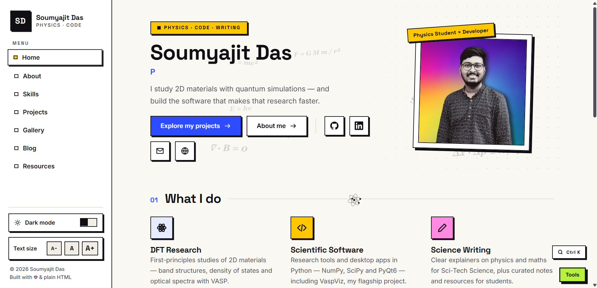
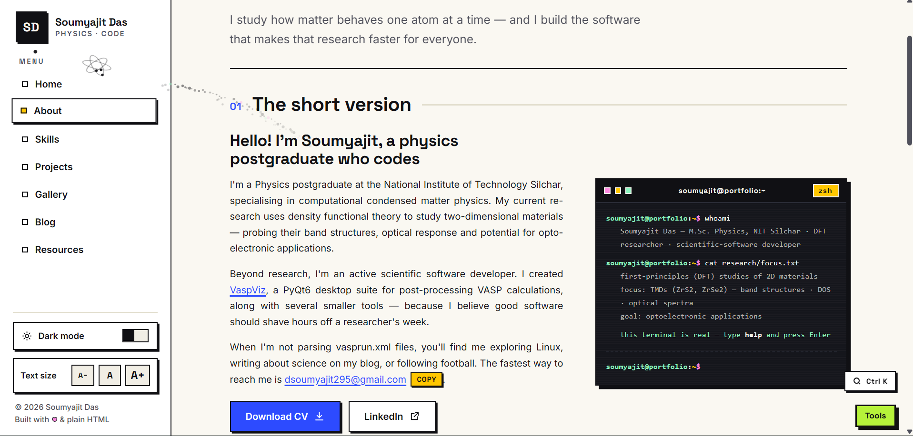
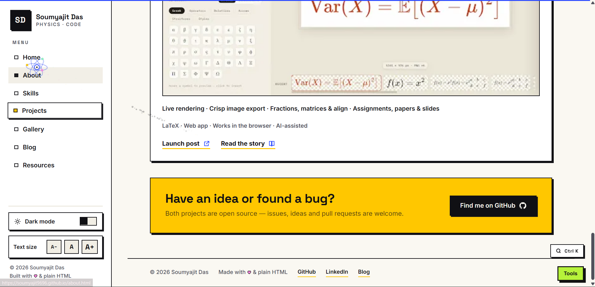

<div align="center">
  
  <h1>Soumyajit Das — Portfolio Template</h1>
  <p><strong>A minimal neobrutalist portfolio for researchers, developers and curious minds.</strong></p>
  <p>
    <a href="https://soumyajit9696.github.io/"><strong>Live portfolio</strong></a>
    ·
    <a href="#-getting-started">Get started</a>
    ·
    <a href="#-customisation">Customise</a>
    ·
    <a href="#-showcase">Showcase</a>
  </p>
  <p>
    
    
    
    
    
  </p>
  <p><sub>Built with plain HTML, CSS and JavaScript · No framework · No build step</sub></p>
</div>

---

## ✦ About the project

This repository contains the source code for my personal portfolio and is shared as a starting point for anyone who wants to build a distinctive, responsive personal website.

The visual direction is **minimal neobrutalism**: crisp borders, confident typography, offset shadows, a warm paper-like background and a small set of vivid accent colours. The template is made with vanilla web technologies, so you can edit it directly without learning a framework or setting up a build pipeline.

> **Please make it your own.** Replace my name, biography, photos, projects, links and other personal content before publishing your version. See the [licensing notes](#-license--usage-rights) before reusing the included assets.

## ✨ Features

- Responsive multi-page layout for desktop, tablet and mobile.
- Minimal neobrutalist visual system with light and dark themes.
- Self-hosted Space Grotesk and Inter variable fonts.
- Interactive navigation, theme switcher and colour palette.
- Animated atom-style pointer on supported desktop devices.
- Physics-inspired floating equations and visual effects.
- Filterable project, skill, gallery and resource sections.
- Keyboard-friendly image lightbox.
- Floating tools dock with small utilities.
- SEO metadata, sitemap, robots file, web manifest and favicon set.
- GitHub Pages-friendly static files; no backend or build tools required.

## 🖼️ Showcase

Add your own screenshots to the `screenshots/` folder and update the filenames below. These image slots are intentionally provided as a showcase area—replace them with screenshots of the pages you want to feature.

<div align="center">
  <h3>Home</h3>
  
  <sub>Homepage · Hero, introduction and featured work</sub>
  <br /><br />
  <h3>About &amp; skills</h3>
  
  <sub>About · Background, interests and skills</sub>
  <br /><br />
  <h3>Projects</h3>
  
  <sub>Projects · Research, software and selected work</sub>
  <br /><br />
  <h3>Gallery &amp; resources</h3>
  
  <sub>Gallery and resources · Visuals, notes and useful links</sub>
</div>

## 📄 Pages included

| File | Purpose |
| --- | --- |
| `index.html` | Homepage, introduction, featured projects and contact links |
| `about.html` | Biography, education, research interests and personal interests |
| `skills.html` | Filterable skills and areas of expertise |
| `projects.html` | Research reports and software projects |
| `gallery.html` | Filterable image gallery with a lightbox |
| `blog.html` | Blog page with Blogger content integration |
| `resources.html` | Learning resources, downloads, bookshelf and playlist |
| `404.html` | Custom not-found page |

## 🧰 Tech stack

| Technology | Use |
| --- | --- |
| HTML5 | Page structure and content |
| CSS3 | Layout, responsive styling, themes and animations |
| Vanilla JavaScript | Interactions and visual effects |
| SVG / WebP | Icons, favicon and image assets |
| GitHub Pages | Optional static hosting |

There is no package manager, framework, bundler or compilation step.

## 🚀 Getting started

### Option 1 — Use this repository as a template

1. Open the repository on GitHub.
2. Click **Use this template → Create a new repository**.
3. Give your repository a name, such as `my-portfolio`.
4. Clone your new repository to your computer:

   ```bash
   git clone https://github.com/YOUR-USERNAME/YOUR-REPOSITORY.git
   cd YOUR-REPOSITORY
   ```

### Option 2 — Fork the repository

1. Click **Fork** at the top of the GitHub repository page.
2. Clone your fork:

   ```bash
   git clone https://github.com/YOUR-USERNAME/YOUR-FORK.git
   cd YOUR-FORK
   ```

### Option 3 — Download the source

Use **Code → Download ZIP** on GitHub, extract the archive, and open the project folder.

### Preview locally

You can open `index.html` directly in a browser. For a local web server, run:

```bash
python -m http.server 8000
```

Then visit <http://localhost:8000>.

## 🎨 Customisation

Start with these files. Search for the existing personal details and replace them with your own.

| What to change | Where to look |
| --- | --- |
| Name, role, biography and page content | `index.html`, `about.html` and other page files |
| Profile picture and gallery images | `images/` |
| Projects and project links | `projects.html` |
| Skills and categories | `skills.html` |
| Blog source / feed details | `blog.html` and `js/main.js` |
| Colours, typography, spacing and layout | `style.css` |
| Navigation, theme and shared interactions | `js/main.js` |
| Cursor animation | `js/cursor.js` |
| Floating physics equations | `js/physics-fx.js` |
| Floating tools dock | `js/brutal-tools.js` |
| Colour palette utility | `js/palette.js` |
| Browser icon and app icons | `favicon/` and `site.webmanifest` |
| Search-engine metadata | Page `<head>` sections, `sitemap.xml` and `robots.txt` |

### Change the website identity

1. Replace the name, role, descriptions and contact information throughout the HTML files.
2. Replace the profile and gallery images in `images/` with images you have permission to use.
3. Replace `favicon/favicon.svg` and the other favicon files with your own logo and icons.
4. Update page titles, descriptions, Open Graph metadata and canonical URLs in each page's `<head>`.
5. Update `site.webmanifest`, `sitemap.xml`, `robots.txt`, `CITATION.cff` and any site-specific URLs.
6. Review `llms.txt` and `llms-full.txt` and replace their personal/project information if you keep them.
7. Remove personal documents, audio and any assets you do not intend to publish.

### Change the theme

The main design system is in `style.css`. Look for the CSS custom properties near the beginning of the file to adjust the colour palette, borders, shadows and other shared design tokens. The fonts are stored in `fonts/`; replace them only with fonts whose licences permit your intended use.

## 🌐 Deploy with GitHub Pages

1. Push your customised project to a GitHub repository.
2. Open **Settings → Pages**.
3. Under **Build and deployment**, choose **Deploy from a branch**.
4. Select your branch (usually `main`) and the `/ (root)` folder, then save.
5. Wait for GitHub Pages to publish your site.
6. If you use a custom domain, configure it in the Pages settings and update your canonical URLs, sitemap and metadata.

Because this is a static website, no server-side runtime is required. Some integrations or external feeds may need their own configuration to work on your deployed domain.

## 📁 Repository structure

```text
.
├── index.html
├── about.html
├── skills.html
├── projects.html
├── gallery.html
├── blog.html
├── resources.html
├── 404.html
├── style.css
├── js/
│   ├── main.js
│   ├── brutal-tools.js
│   ├── cursor.js
│   ├── palette.js
│   └── physics-fx.js
├── images/
├── fonts/
├── favicon/
├── docs/                 # Remove or replace personal documents
├── Songs/                # Review included audio and its rights
├── screenshots/          # Add your README showcase screenshots here
├── CITATION.cff
├── sitemap.xml
├── robots.txt
├── site.webmanifest
├── llms.txt
├── llms-full.txt
├── LICENSE
└── README.md
```

## ⚖️ License & usage rights

The reusable website source code authored for this template is released under the **MIT License**. You may use, copy, modify, merge, publish, distribute, sublicense and sell copies of that source code, subject to the license terms.

**The MIT license does not automatically grant rights to every asset in this repository.** Unless a file says otherwise, the following personal materials are excluded and remain the property of their respective owners:

- Personal photographs, portraits and gallery images.
- CVs, résumés, certificates and other personal documents.
- Personal writing, research material and project content.
- Name, likeness, personal identity and branding.
- Third-party fonts, music, logos, illustrations and other assets, which remain subject to their own licences or permissions.

Do not redistribute these excluded materials, present yourself as the original author, or use the author's identity or branding in a way that suggests endorsement. Before publishing your customised site, replace or remove assets you do not have permission to use. See [`LICENSE`](LICENSE) for the full terms and scope.

## 🙌 Attribution

Attribution is appreciated but not required by the MIT License. If you share a version based on this template, you are welcome to link back to this repository.

## 📬 Contact

- **Website:** <https://soumyajit9696.github.io/>
- **GitHub:** <https://github.com/soumyajit9696>

---

<div align="center">
  <sub>Designed and built by <a href="https://soumyajit9696.github.io/">Soumyajit Das</a> · Made for the curious.</sub>
</div>
